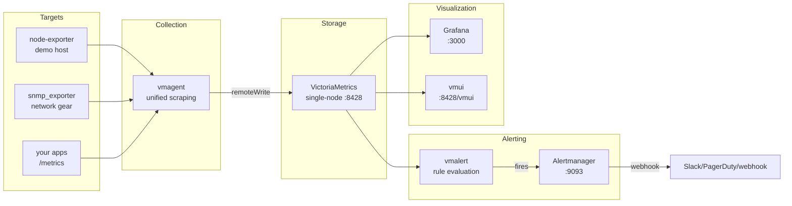

# VictoriaMetrics Monitoring Stack

[](https://github.com/VictoriaMetrics/VictoriaMetrics/releases)
[](https://github.com/grafana/grafana/releases)
[](https://www.docker.com)
[](LICENSE)

**[中文版](README_zh.md) | English**

**Not another "Prometheus one-click deploy".** A production-leaning,
single-node VictoriaMetrics + Grafana monitoring stack: one command to start,
with a Prometheus zero-downtime migration guide, capacity planning cheat sheet,
and SNMP network-device integration.

## Why VictoriaMetrics?

| Pain | Prometheus | This stack (VictoriaMetrics) |
|------|-----------|------------------------------|
| Long-term storage | Local disk doesn't scale; Thanos/Cortex are heavy to operate | Single node holds 12 months; ~7x less storage |
| High-cardinality metrics | Memory blowups, OOM kills | ~7x less RAM, purpose-built for high churn |
| Collection | Server both scrapes and stores | vmagent scrapes, lightweight, fans out via remoteWrite |
| Query language | PromQL | PromQL-compatible, plus MetricsQL superset |

> Figures from VictoriaMetrics official docs and public benchmarks.
> Check [docs/capacity-planning.md](docs/capacity-planning.md) before sizing.

## Architecture



## Quick start

```bash
# 1. Set passwords / webhook (optional)
cp .env.example .env

# 2. Start (first run pulls images)
docker compose up -d

# 3. Verify
docker compose ps
```

Then open:

| Service | URL | Notes |
|---------|-----|-------|
| Grafana | http://localhost:3000 | default admin / admin123 (change in .env); VM datasource + overview dashboard pre-provisioned |
| vmui | http://localhost:8428/vmui | VictoriaMetrics built-in query UI, no login |
| vmalert | http://localhost:8880 | alert rule status |
| Alertmanager | http://localhost:9093 | alert routing status |
| vmagent | http://localhost:8429 | scrape targets at `/targets` |

> A demo node-exporter is included, so the full pipeline produces data immediately.

## Docs

- [Prometheus → VictoriaMetrics zero-downtime migration](docs/en/migration-prometheus-to-vm.md) — dual-write in 3 phases
- [Capacity planning cheat sheet](docs/en/capacity-planning.md) — how much RAM/disk per million series
- [SNMP network-device integration](docs/en/snmp-integration.md) — pairs with [snmp-mib-ui](https://github.com/Oumu33/snmp-mib-ui): pick OIDs visually, generate vmagent scrape configs in one click

> Chinese versions live in [docs/](docs/) ([迁移实战](docs/migration-prometheus-to-vm.md) ·
> [容量规划](docs/capacity-planning.md) · [SNMP 接入](docs/snmp-integration.md)).

## FAQ

**Single-node enough? When to go cluster?**
Upstream recommends single-node below ~1M data points/sec — it's an order of
magnitude simpler to operate. Split into vminsert/vmstorage/vmselect only at real bottlenecks.

**How do alerts reach Slack/PagerDuty?**
Alertmanager POSTs to `${ALERT_WEBHOOK_URL}` (set in `.env`). critical alerts
are routed separately so they can hit a different receiver (e.g. phone gateway).

**Migrating from Prometheus?**
See the [migration guide](docs/migration-prometheus-to-vm.md): vmagent dual-write +
vmctl for history, zero downtime, rollback plan included.

**Retention & backups?**
Default 12 months (`VM_RETENTION_PERIOD`), data in the `vm-data` volume.
Use upstream `vmbackup` / `vmrestore` for backups.

## Layout

```
.
├── docker-compose.yml            # full stack
├── .env.example                  # env template
├── config/
│   ├── vmagent/scrape.yml        # scrape config (Prometheus-compatible)
│   ├── vmalert/rules/            # alert rules (hosts + VM self-monitoring)
│   ├── alertmanager/             # routing & inhibition
│   └── grafana/                  # datasource + dashboard provisioning
└── docs/
    ├── migration-prometheus-to-vm.md
    ├── capacity-planning.md
    ├── snmp-integration.md
    └── promo/                    # promo drafts
```

## License

MIT — see [LICENSE](LICENSE).
