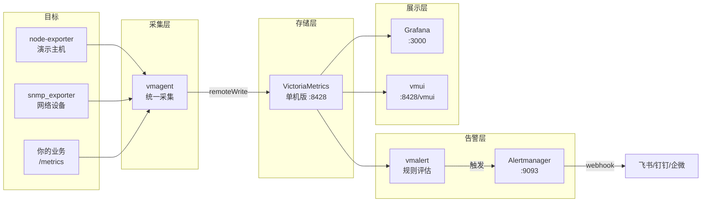

# VictoriaMetrics 监控栈（中文生产级）

[](https://github.com/VictoriaMetrics/VictoriaMetrics/releases)
[](https://github.com/grafana/grafana/releases)
[](https://www.docker.com)
[](LICENSE)

**这不是又一个"Prometheus 一键部署"。** 这是一个以 VictoriaMetrics 为存储核心、
面向中文运维的生产级监控栈：一条命令启动，附带 Prometheus 迁移实战、容量规划、
SNMP 设备接入等中文文档。

## 为什么是 VictoriaMetrics？

| 痛点 | Prometheus | 本栈（VictoriaMetrics） |
|------|-----------|------------------------|
| 长期存储 | 本地盘扛不住，Thanos/Cortex 运维复杂 | 单机即可存 12 个月，存储占用少约 7 倍 |
| 高基数指标 | 内存爆炸、OOM | 内存占用少约 7 倍，高基数场景专门优化 |
| 采集 | Prometheus Server 又采又存 | vmagent 专职采集，轻量、可远程写多份 |
| 查询语言 | PromQL | 兼容 PromQL，另有 MetricsQL 超集 |

> 数据来源：VictoriaMetrics 官方文档与公开压测。是否适合你，先看
> [docs/capacity-planning.md](docs/capacity-planning.md) 容量规划再决定。

## 架构



## 快速开始

```bash
# 1. 准备环境变量（按需改密码）
cp .env.example .env

# 2. 启动（首次会拉镜像，请耐心等待）
docker compose up -d
# 或 make up

# 3. 启用 SNMP 采集（可选，需先用 snmp-mib-ui 生成 snmp.yml）
# docker compose --profile snmp up -d

# 4. 验证
docker compose ps
```

启动后访问：

| 服务 | 地址 | 说明 |
|------|------|------|
| Grafana | http://localhost:3000 | 默认 admin / admin123（.env 可改），已预置 VM 数据源与总览看板 |
| vmui | http://localhost:8428/vmui | VictoriaMetrics 内置查询 UI，免登录 |
| vmalert | http://localhost:8880 | 告警规则状态 |
| Alertmanager | http://localhost:9093 | 告警接收与路由状态 |
| vmagent | http://localhost:8429 | 抓取目标状态看 `/targets` |

> 自带 node-exporter 演示目标，启动后即有数据，整条链路可直接验证。

## 进阶文档

- [Prometheus → VictoriaMetrics 双写迁移实战](docs/migration-prometheus-to-vm.md) —— 不停机迁移三步法
- [容量规划速查](docs/capacity-planning.md) —— 多少指标配多少内存磁盘
- [SNMP 网络设备接入](docs/snmp-integration.md) —— 联动 [snmp-mib-ui](https://github.com/Oumu33/snmp-mib-ui)，MIB 可视化选指标、一键生成 vmagent 抓取配置
- 英文版文档在 [docs/en/](docs/en/)（[English docs](docs/en/migration-prometheus-to-vm.md)）

## 常见问题

**Q: 单机版够用吗？什么时候上集群版？**
A: 官方建议：每秒百万级数据点以下，单机版完全够用，且运维简单一个数量级。
先单机，真到瓶颈再拆 vminsert/vmstorage/vmselect。

**Q: 告警怎么推到飞书/钉钉？**
A: 直接改 `config/alertmanager/alertmanager.yml` 里两个 `url` 字段
（alertmanager 不会自动展开环境变量，别写 `${...}`）。
推荐部署 [prometheus-webhook-dingtalk](https://github.com/timonwong/prometheus-webhook-dingtalk)
这类网关做格式转换，把网关地址填进去，重启 alertmanager 即可。
critical 级别已单独路由，可接不同的网关（比如电话告警）。

**Q: 已有 Prometheus，怎么迁？**
A: 看 [迁移实战](docs/migration-prometheus-to-vm.md)。核心是 vmagent 双写 +
vmctl 迁历史数据，业务零感知，可回滚。

**Q: 数据保留多久？存在哪？**
A: 默认保留 12 个月（`VM_RETENTION_PERIOD` 可调，`docker-compose.yml` 里改），
数据在 `vm-data` 数据卷。备份用官方 `vmbackup` / 恢复用 `vmrestore`。

## 实用脚本（scripts/）

| 脚本 | 用途 |
|------|------|
| `capacity-calculator.py` | 交互式容量计算器：输入指标规模，输出内存/磁盘/CPU 建议 |
| `migrate-check.py` | 双写一致性检查：对比 Prometheus 与 VM 的关键指标，迁移时验证用 |
| `backup.sh` | vmbackup 备份 / vmrestore 恢复（含快照） |

```bash
python3 scripts/capacity-calculator.py
python3 scripts/migrate-check.py http://prometheus:9090 http://vm:8428
./scripts/backup.sh backup          # 备份
./scripts/backup.sh restore 20261004 # 恢复
```

## 目录结构

```
.
├── docker-compose.yml            # 全栈编排
├── .env.example                  # 环境变量模板
├── config/
│   ├── vmagent/scrape.yml        # 抓取配置（Prometheus 兼容语法）
│   ├── vmalert/rules/            # 告警规则（主机 + VM 自监控）
│   ├── alertmanager/             # 告警路由与抑制
│   └── grafana/                  # 数据源/看板预置
└── docs/
    ├── migration-prometheus-to-vm.md
    ├── capacity-planning.md
    ├── snmp-integration.md
    └── promo/                    # 推广文章草稿
```

## License

MIT，详见 [LICENSE](LICENSE)。
